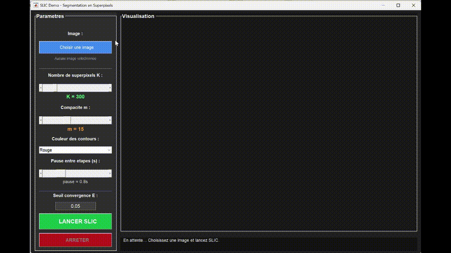
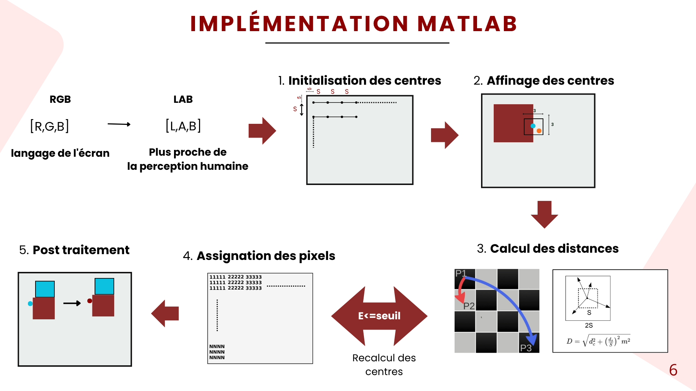
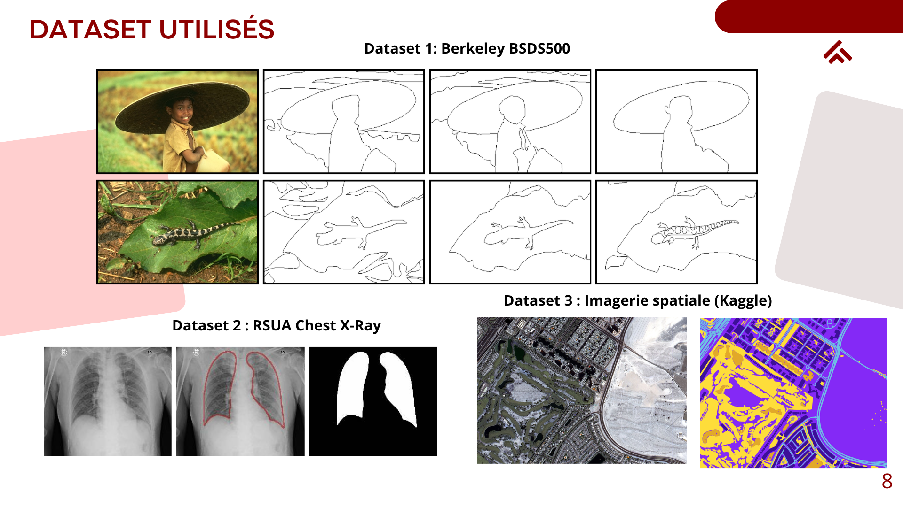
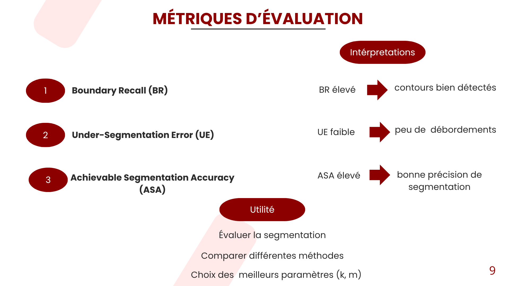
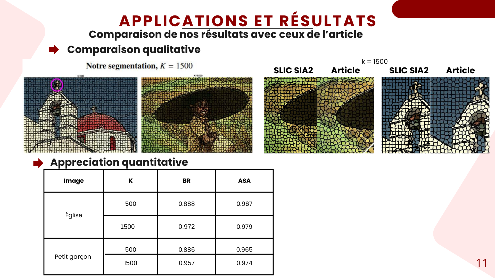
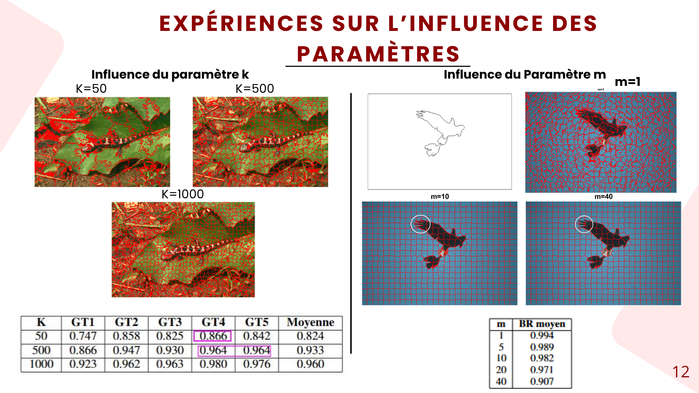

# SLIC Superpixel Segmentation

MATLAB implementation and experimental evaluation of the **Simple Linear Iterative Clustering (SLIC)** algorithm for superpixel segmentation.

This project was carried out as part of the **Research Initiation Project** of the Master's program in **Signal, Image and Machine Learning (SIA2)** at Université de Toulouse.

## Demo

<p align="center">
  
</p>

The interactive MATLAB interface allows the user to select an image, adjust the number of superpixels **K** and the compactness parameter **m**, and visualize the different stages of the SLIC algorithm until convergence.

▶️ [View the original MP4 demo](demo/SLIC_demo.mp4)

---

## Project objectives

The project aimed to:

- Reconstruct the SLIC algorithm from its original formulation.
- Understand and implement each stage of the algorithm in MATLAB.
- Study the influence of the two main parameters:
  - **K** — desired number of superpixels
  - **m** — compactness parameter
- Evaluate segmentation quality on different types of images.
- Investigate the compromise between boundary adherence and superpixel regularity.

---

## SLIC algorithm

Each pixel is represented in a five-dimensional space:

\[
[L,\;a,\;b,\;x,\;y]
\]

where \(L,a,b\) represent the pixel color in the **CIELAB color space**, while \(x,y\) represent its spatial position.

The algorithm minimizes a distance combining color similarity and spatial proximity:

\[
D =
\sqrt{
d_c^2 +
\left(\frac{m}{S}\right)^2 d_s^2
}
\]

where:

- \(d_c\) is the color distance,
- \(d_s\) is the spatial distance,
- \(S\) is the average spacing between cluster centers,
- \(m\) controls the compactness of the superpixels.

---

## Implementation

The MATLAB implementation was divided into several functions corresponding to the main stages of SLIC:

1. RGB to CIELAB conversion
2. Cluster center initialization
3. Center refinement using local image gradients
4. Local pixel assignment
5. Cluster center recomputation
6. Iterative convergence
7. Connectivity enforcement
8. Orphan-pixel correction
9. Removal of very small regions

The local search is restricted to a region around each cluster center instead of comparing every pixel with every center, which is one of the key principles behind the computational efficiency of SLIC.

<p align="center">
  
</p>

---

## Datasets

The implementation was tested on several types of images:

- **Berkeley Segmentation Dataset (BSDS500)**
- **Chest X-ray images**
- **Aerial and space imagery**

<p align="center">
  
</p>

Using different image domains allowed us to observe how the choice of SLIC parameters depends on image content and application.


---

## Evaluation metrics

To evaluate the quality of the generated superpixels, we used standard superpixel segmentation metrics:

- **Boundary Recall (BR)**: measures how well superpixel boundaries align with reference object boundaries.
- **Under-Segmentation Error (UE)**: measures the extent to which superpixels leak across different regions.
- **Achievable Segmentation Accuracy (ASA)**: measures how accurately the superpixels can represent the ground-truth segmentation.

These metrics are useful for comparing segmentation quality and for choosing appropriate values of **K** and **m**.

<p align="center">
  
</p>

---

## Quantitative results

The implementation was evaluated both qualitatively and quantitatively on several images.

The results show that increasing the number of superpixels generally improves boundary adherence and segmentation accuracy, especially for images containing fine details or complex structures.

<p align="center">
  
</p>

---

## Influence of the parameters

The experiments also focused on the influence of the two main SLIC parameters:

- **K**: desired number of superpixels
- **m**: compactness parameter

A larger **K** produces smaller and more detailed superpixels, while **m** controls the trade-off between boundary adherence and spatial regularity:

- smaller **m** → superpixels better follow image contours
- larger **m** → superpixels become more regular and compact

<p align="center">
  
</p>


---

## Interactive MATLAB demo

An interactive graphical interface was developed to visualize the internal behavior of SLIC.

It displays:

- initial cluster centers,
- displacement toward low-gradient regions,
- first pixel assignment,
- iterative evolution of the superpixels,
- convergence error,
- final segmentation after post-processing.

The parameters **K**, **m**, maximum number of iterations and visualization speed can be modified directly from the interface.

---

## Repository structure

```text
SLIC-GitHub/
│
├── src/
│   ├── SLIC_SIA2.m
│   ├── initialiser_centres.m
│   ├── affiner_centres.m
│   ├── calculer_distance.m
│   ├── assigner_pixels.m
│   ├── recalculer_centres.m
│   ├── ges_connexite.m
│   ├── combler_orphelins.m
│   └── supprimer_petits.m
│
├── benchmark/
│   ├── boundary_recall.m
│   ├── calcule_ASA.m
│   ├── eval_dataset.m
│   └── ...
│
├── demo/
│   ├── SLIC_Demo_GUI.m
│   ├── SLIC_demo.gif
│   └── SLIC_demo.mp4
│
├── paper/
│   └── SLIC_Superpixel_Segmentation_Report.pdf
│
├── presentation/
│   ├── Slic_presentation.pptx
│   └── 1.png ... 20.png
│
└── README.md
```

---

## Full research report

The complete project methodology, implementation details, experiments and results are available in the project report:

### 📄 [Read the full research report](paper/SLIC_Superpixel_Segmentation_Report.pdf)

---

## Presentation

The complete project presentation is also available here:

### 📊 [Download the project presentation](presentation/Slic_presentation.pptx)

---

## Technologies

- MATLAB
- Image Processing
- Superpixel Segmentation
- CIELAB color space
- Image Gradient Analysis
- Connected Components
- Quantitative Segmentation Evaluation

---

## Authors

**P. Donfack**  
**F. Awounang**  
**S. Kaba**  
**M. Kabawa**

Master 1 — Signal, Image & Machine Learning (SIA2)  
Université de Toulouse — Faculté des Sciences et Ingénierie  
Academic year 2025–2026

**Supervisor:** A. Herbulot
